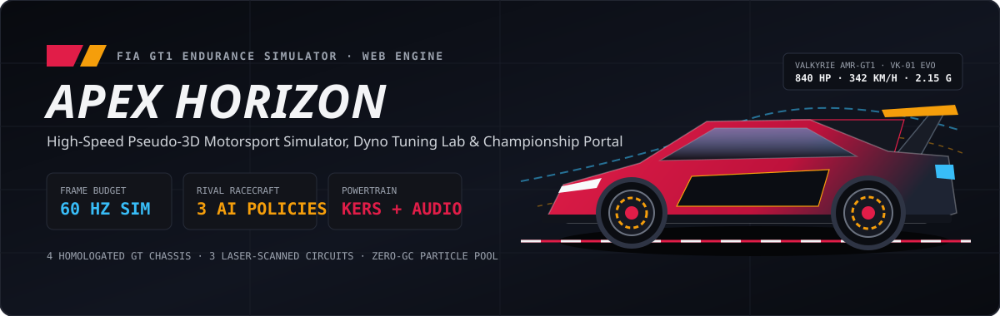
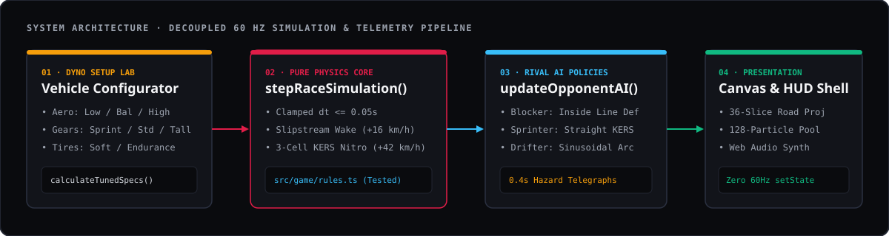
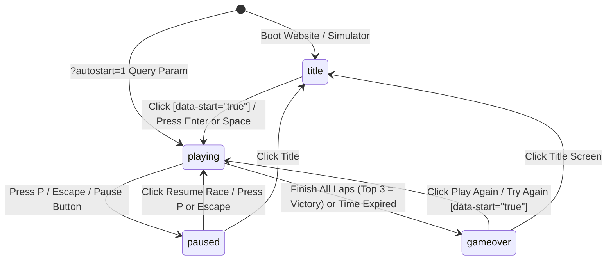
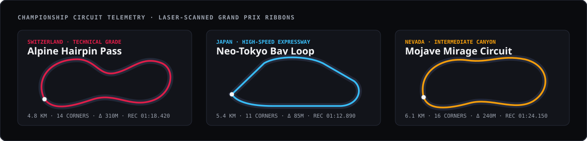

<div align="center">



# APEX HORIZON — Motorsport Racing & Telemetry

**High-Speed Pseudo-3D Browser Racing Simulator · Interactive Dyno Setup Lab · Championship Standings Portal**

[](#architecture--simulation-pipeline)
[](#architecture--simulation-pipeline)
[](#cockpit-hud--viewport-layout)
[](#procedural-powertrain-audio)
[-10B981?style=flat-square)](#testing--verification)

</div>

---

## Overview

**Apex Horizon** combines an official motorsport championship portal with an instant-play **60 FPS pseudo-3D racing simulator**. Players can inspect and tune four homologated GT/Prototype machines on a live mechanical dyno, study sector telemetry across three international circuits, and launch directly into wheel-to-wheel races against three autonomous AI driver archetypes.

### Key Highlights

- **Custom 36-Slice Pseudo-3D Road Engine**: Projects dynamic road curvature, elevation hills, FIA red-and-white rumble curbs, lane markers, and roadside grandstands at 60 Hz with zero garbage-collection stalls.
- **Live Mechanical Dyno Configurator**: Adjust **Aero Downforce Trim**, **Sequential Gear Ratio**, and **Slick Tire Compound** in the garage—every change dynamically recalculates terminal velocity, $0\text{–}100\text{ km/h}$ launch sprint, and sustained lateral G-force, and feeds directly into the active race physics.
- **Three Distinct Rival AI Policies**: Race against *Apex Blockers*, *Slipstream Sprinters*, and *Outrun Sweepers* complete with $0.4\text{s}$ visual hazard telegraphs before high-speed lane maneuvers.
- **Decoupled 60 Hz DOM-Ref HUD**: High-frequency telemetry readouts (Speed, Gear, RPM shift bar, KERS Nitro drain ghost bar, and live circuit radar dot) mutate directly via DOM refs without triggering React reconciliation inside `requestAnimationFrame`.

---

## Architecture & Simulation Pipeline



### Game Shell State Machine

The simulator mirrors its active lifecycle state directly to `document.body.dataset.state` (`'title' | 'playing' | 'paused' | 'gameover'`) and supports `?autostart=1` for instant full-viewport track launch:



---

## Cockpit HUD & Viewport Layout

During active gameplay (`document.body.dataset.state === 'playing'`), over **85% of the viewport** remains unobstructed playfield, routing critical telemetry to compact perimeter clusters:

```text
+-----------------------------------------------------------------------------------+
| [ POS 3/8 | LAP 1/2 | TIME REM 118s | POINTS 1,420 ]     [RADAR] [M] [R] [P] [EXIT]|
|                                                                                   |
|                                                                                   |
|                        +-------------------------------+                          |
|                        |  SLIPSTREAM DRAFT +16 KM/H    |  <-- Center Gaze Cue     |
|                        +-------------------------------+                          |
|                                  /     |     \                                    |
|                                 /   [RIVAL]   \                                   |
|                                /       |       \                                  |
|                               /    [PLAYER]     \                                 |
|                              /   * * * * * * *   \  <-- 128-Particle Ring Buffer  |
|                                                                                   |
| [ ◀ ] [ ▶ ] [ NITRO (SPACE) ]                  +--------------------------------+ |
|                                                | 342 KM/H               GEAR G7 | |
|                                                | [████████████████████░░░░░░░░] | |
|                                                | KERS NITRO CELLS     [■] [◪] [□]| |
|                                                | [████████████▒▒▒▒▒▒░░░░░░░░░░] | |
+------------------------------------------------+--------------------------------+
```

---

## Homologated Vehicle Roster & Dyno Matrix

Every vehicle in the paddock can be tuned across **18 setup combinations** before launching onto the circuit:

| Chassis Name | Code | Class | Drivetrain | Power / Weight | Base Top Speed | $0\text{–}100\text{ km/h}$ | Lateral Grip |
| :--- | :--- | :--- | :--- | :--- | :---: | :---: | :---: |
| **Valkyrie AMR-GT1** | `VK-01 EVO` | GT1 Prototype | RWD 7-Speed Sequential | $840\text{ HP} \cdot 1,080\text{ kg}$ | $342\text{ km/h}$ | $2.40\text{ s}$ | $2.15\text{ G}$ |
| **Solaris RS-Clubsport** | `SR-992 GT` | Track Spec | AWD Torque-Vectoring | $690\text{ HP} \cdot 1,220\text{ kg}$ | $318\text{ km/h}$ | $2.70\text{ s}$ | $2.02\text{ G}$ |
| **Vantablack ZR-Twin** | `VB-34 SPEC` | Street Tuned | RWD 6-Speed Dogbox | $640\text{ HP} \cdot 1,340\text{ kg}$ | $308\text{ km/h}$ | $2.90\text{ s}$ | $1.84\text{ G}$ |
| **Aetherion LMP-Evo** | `AE-9X HYBRID` | GT1 Prototype | Hybrid E-AWD Sequential | $910\text{ HP} \cdot 995\text{ kg}$ | $352\text{ km/h}$ | $2.30\text{ s}$ | $2.24\text{ G}$ |

### Comparative Performance Profile (Base Trim)

```text
Terminal Velocity (km/h)
Aetherion LMP-Evo     ███████████████████████████████████ 352 km/h
Valkyrie AMR-GT1      ██████████████████████████████████  342 km/h
Solaris RS-Clubsport  ███████████████████████████████     318 km/h
Vantablack ZR-Twin    ██████████████████████████████      308 km/h

Cornering Lateral Force (G)
Aetherion LMP-Evo     ████████████████████████████████████ 2.24 G
Valkyrie AMR-GT1      ██████████████████████████████████   2.15 G
Solaris RS-Clubsport  ████████████████████████████████     2.02 G
Vantablack ZR-Twin    █████████████████████████████        1.84 G
```

### Dyno Tuning Modifiers (`calculateTunedSpecs`)

| Component | Setting | Top Speed $\Delta$ | $0\text{–}100\text{ km/h}$ $\Delta$ | Cornering Grip $\Delta$ | Best Suited For |
| :--- | :--- | :---: | :---: | :---: | :--- |
| **Aero Downforce** | `Low Drag` | $+11\text{ km/h}$ | $-0.04\text{ s}$ | $-0.11\text{ G}$ | Neo-Tokyo Bay Loop expressway straights |
| **Aero Downforce** | `Balanced` | $0\text{ km/h}$ | $0.00\text{ s}$ | $0.00\text{ G}$ | All-around mixed sector performance |
| **Aero Downforce** | `High Aero` | $-9\text{ km/h}$ | $+0.05\text{ s}$ | $+0.16\text{ G}$ | Alpine Hairpin Pass technical switchbacks |
| **Gear Ratio** | `Short Sprint` | $-8\text{ km/h}$ | $-0.18\text{ s}$ | $0.00\text{ G}$ | Rapid corner-exit acceleration |
| **Gear Ratio** | `Tall Top-End` | $+10\text{ km/h}$ | $+0.14\text{ s}$ | $0.00\text{ G}$ | High-speed slipstream drafting |
| **Tire Compound** | `Soft Slick` | $0\text{ km/h}$ | $-0.08\text{ s}$ | $+0.12\text{ G}$ | Maximum qualifying grip & apex speed |
| **Tire Compound** | `Medium Endurance` | $+3\text{ km/h}$ | $0.00\text{ s}$ | $-0.04\text{ G}$ | Low rolling resistance on desert tarmac |

---

## Grand Prix Circuit Calendar



| Circuit | Location | Length | Corners | Elevation $\Delta$ | Surface | Official Lap Record |
| :--- | :--- | :---: | :---: | :---: | :--- | :--- |
| **Alpine Hairpin Pass** | Bernese Oberland, Switzerland | $4.8\text{ km}$ | $14$ | $310\text{ m}$ | Dry Granite Tarmac | `01:18.420` (*M. Lindqvist*) |
| **Neo-Tokyo Bay Loop** | Wangan & Shibaura, Japan | $5.4\text{ km}$ | $11$ | $85\text{ m}$ | Night Polymer Asphalt | `01:12.890` (*K. Takahashi*) |
| **Mojave Mirage Circuit** | Red Rock Basin, Nevada | $6.1\text{ km}$ | $16$ | $240\text{ m}$ | Abrasive Desert Tarmac | `01:24.150` (*S. Vance*) |

---

## Opponent AI Archetypes

Rather than spawning identical speed-following bots, `updateOpponentAI` in `src/game/rules.ts` implements three distinct racecraft policies:

1. **Apex Blocker (`'blocker'`) — Crimson / Amber Livery**
   - Monitors the player's lateral lane offset (`playerX`) whenever the player closes within $160\text{ m}$ from behind.
   - Smoothly weaves across the road (`targetLaneX = clamp(playerX * 0.88, -0.72, 0.72)`) to defend the inside overtaking line while flashing an amber hazard telegraph.
2. **Slipstream Sprinter (`'sprinter'`) — Amber / Cyan Livery**
   - Hugs the geometric racing apex through corners (`targetLaneX = -segment.curve * 0.5`).
   - Deploys periodic straightaway KERS bursts (`+36 km/h`) whenever `|segment.curve| < 0.35`.
3. **Outrun Sweeper (`'drifter'`) — Cyan / Crimson Livery**
   - Carves wide sinusoidal out-in-out arcs across the tarmac and maintains high momentum through sweeping curves, telegraphing wide lane transitions $0.4\text{ s}$ in advance.

---

## Controls & Shortcuts

| Action | Keyboard Binding | Touch / Pointer Control |
| :--- | :--- | :--- |
| **Accelerate / Throttle** | `W` or `ArrowUp` | Auto-throttle on `NITRO [SPACE]` hold |
| **Brake / Decelerate** | `S` or `ArrowDown` | Release throttle |
| **Steer Left / Right** | `A` / `D` or `ArrowLeft` / `ArrowRight` | On-screen `◀` and `▶` buttons |
| **Deploy KERS Nitro Boost** | `Space` or `Shift` | On-screen `NITRO [SPACE]` button |
| **Pause / Resume Session** | `P` or `Escape` | Top-right Pause icon button |
| **Instant Session Restart** | `R` | Top-right Restart icon button |
| **Toggle Powertrain Audio** | `M` | Top-right Speaker icon button |

---

## Project Structure

```text
/
├── public/
│   └── docs/
│       ├── readme-hero-banner.svg          # Vector hero banner & GT1 aero diagram
│       ├── readme-architecture-diagram.svg # 4-stage simulation & telemetry pipeline
│       └── readme-track-telemetry.svg      # Grand Prix circuit comparison cards
├── src/
│   ├── components/
│   │   ├── CarArtworkSvg.tsx               # Bespoke SVG studio vehicle & track renders
│   │   ├── CircuitsAndLeagueSection.tsx    # Circuit explorer, standings & validated form
│   │   ├── GarageSection.tsx               # Vehicle roster & interactive dyno setup lab
│   │   └── RaceCanvasView.tsx              # 60 Hz Canvas2D simulator & world-matched HUD
│   ├── game/
│   │   ├── rules.ts                        # Pure physics, dyno math, AI policies & validation
│   │   ├── rules.test.ts                   # Node built-in unit test suite (node:test)
│   │   └── sound.ts                        # Procedural Web Audio API synthesizer
│   ├── App.tsx                             # Top bar contract, layout & fullscreen game shell
│   ├── index.css                           # Tailwind v4 & typography rules
│   └── main.tsx                            # Application entry point
├── index.html
├── package.json
└── vite.config.ts
```

---

## Getting Started & Verification

### 1. Install Dependencies & Start Dev Server

```bash
npm install
npm run dev
```

Open `http://localhost:3000` to explore the championship website and embedded simulator, or open `http://localhost:3000/?autostart=1` to launch directly into the full-viewport racing shell.

### 2. Run Decoupled Unit Tests

Core simulation rules, dyno math, opponent AI policies, podium victory detection, and registration form validation are tested via Node's built-in test runner:

```bash
npx --yes tsx --test src/game/rules.test.ts
```

### 3. Production Build

```bash
npm run build
```
